<h1 align="center">Bilgehan Zeki Özaytaç</h1>
<h3 align="center">Eğitmen ve Mentor · Uygulamalı Araştırmacı · Teknoloji ve Yazılım Danışmanı</h3>

  
  
  
  
  

Uzun yıllardır yazılım geliştirme, sistem yönetimi, gömülü sistemler ve IoT, veri tabanları, ulaşım ve biletleme otomasyonu ile canlı e-spor yayın grafikleri alanlarında çalışıyorum. Bugün Python, Git/GitHub, .NET, veri bilimi, Gemini ve yapay zekâ ajanları üzerine eğitim ve mentorluk veriyor, eğitim projeleri için araştırma yazılımı geliştiriyor ve teknoloji danışmanlığı yapıyorum.

- 🔭 Bursa Uludağ Üniversitesinde **SODEM-AI** ve bir **TÜBİTAK 3005** projesinde araştırmacı ve yazılım geliştiriciyim (öğretmenlerin mesleki gelişimi, sosyal-duygusal öğrenme, öğrenme güçlükleri)
- 🎓 Bursa Teknik Üniversitesi Endüstri Mühendisliği yüksek lisans: yükseköğretimde bütünleşik öğrenci ve paydaş etkileşim sistemleri
- 🤖 TanStack AI ve MCP üzerinde çok makineli bir ajan orkestrası olan **suru**'yu geliştiriyorum (Claude Code, Codex, Antigravity)
- 💬 Bana sorabileceklerin: **C#, .NET, Python, TypeScript, LLM ajanları, MCP, RAG, eğitim teknolojileri**

<h3>Diller ve araçlar</h3>

  
  
  
  
  
  
  
  
  

  
  
  
  
  
  
  
  
  

  
  
  
  
  
  
  
  
  

  
  
  
  
  
  
  
  
  

  
  
  
  
  
  

<h3>GitHub istatistikleri</h3>

  
  

  

  

